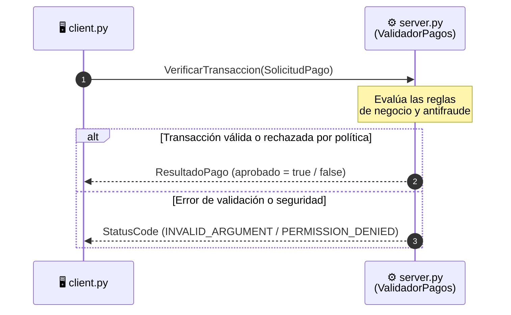
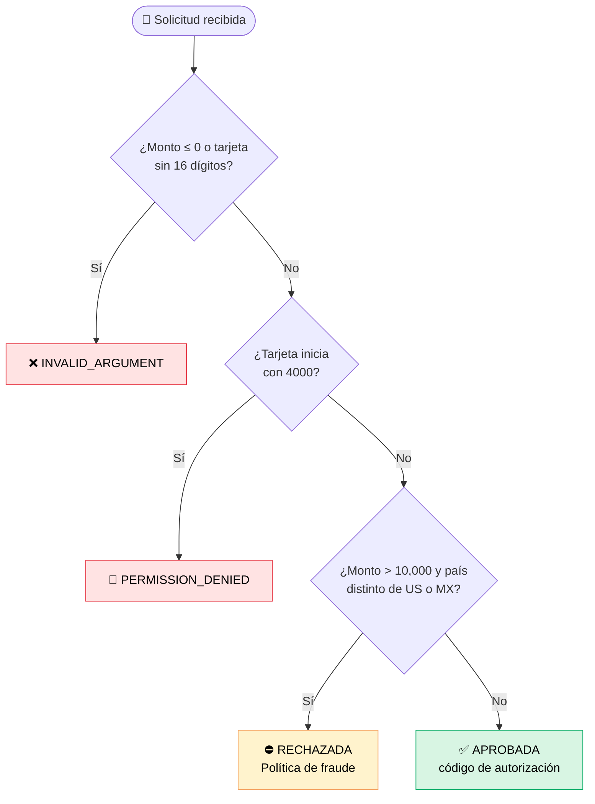

<div align="center">

# 🛒 Microservicio de Validación de Pagos

### gRPC Unario · Ejercicio 1

Validación de transacciones de e-commerce en tiempo real con **gRPC** y **Protocol Buffers**, aplicando reglas de negocio y políticas antifraude.

<br />


</div>

---

## 📑 Tabla de contenido

- [Objetivo del proyecto](#-objetivo-del-proyecto)
- [Tecnologías utilizadas](#️-tecnologías-utilizadas)
- [Cómo funciona](#-cómo-funciona)
- [Contrato Protobuf](#-contrato-protobuf)
- [Estructura del proyecto](#-estructura-del-proyecto)
- [Guía de ejecución paso a paso](#-guía-de-ejecución-paso-a-paso)
- [Casos de prueba incluidos](#-casos-de-prueba-incluidos)
- [Solución de problemas](#-solución-de-problemas)

---

## 🎯 Objetivo del Proyecto

Construir un servicio con un **patrón unario** que reciba peticiones de pago y responda de forma síncrona si la transacción es `APROBADA` o `RECHAZADA`, manejando adecuadamente los códigos de estado gRPC para excepciones de red y reglas de negocio.

> 💡 **Patrón unario:** el cliente envía **una** solicitud y el servidor devuelve **una** respuesta, igual que una llamada a función, pero a través de la red.

---

## 🛠️ Tecnologías Utilizadas

| Componente | Tecnología |
| :--- | :--- |
| 🐍 **Lenguaje** | Python 3.x |
| ⚡ **Framework RPC** | gRPC (`grpcio`, `grpcio-tools`) |
| 📦 **Serialización** | Protocol Buffers (proto3) |
| 🧵 **Concurrencia del servidor** | `ThreadPoolExecutor` con 10 hilos |
| 🔌 **Puerto** | `50051` (canal sin cifrado, solo para desarrollo) |

---

## 🧠 Cómo funciona



---

## 📜 Contrato Protobuf

El archivo `pagos.proto` define el servicio y los dos mensajes que intercambian cliente y servidor.

**Servicio:** `ValidadorPagos` → método `VerificarTransaccion(SolicitudPago) returns (ResultadoPago)`

<table>
<tr>
<td valign="top">

**📤 `SolicitudPago`**

| # | Campo | Tipo |
| :-: | :--- | :--- |
| 1 | `id_transaccion` | `string` |
| 2 | `numero_tarjeta` | `string` |
| 3 | `monto` | `double` |
| 4 | `codigo_moneda` | `string` |
| 5 | `pais_origen` | `string` |

</td>
<td valign="top">

**📥 `ResultadoPago`**

| # | Campo | Tipo |
| :-: | :--- | :--- |
| 1 | `aprobado` | `bool` |
| 2 | `codigo_autorizacion` | `string` |
| 3 | `motivo_rechazo` | `string` |

</td>
</tr>
</table>

---

## 🛡️ Reglas de negocio

El servidor evalúa cada transacción **en orden**. La primera regla que se cumple detiene el proceso.



| # | Regla | Resultado | Tipo de respuesta |
| :-: | :--- | :--- | :--- |
| 1️⃣ | Monto menor o igual a 0, o tarjeta sin 16 dígitos | `INVALID_ARGUMENT` | Excepción gRPC |
| 2️⃣ | Tarjeta en lista negra (inicia con `4000`) | `PERMISSION_DENIED` | Excepción gRPC |
| 3️⃣ | Monto mayor a **$10,000 USD** con país fuera de `US` o `MX` | `RECHAZADA` · "Política de fraude" | `ResultadoPago` con `aprobado = false` |
| ✅ | Pasa todas las validaciones | `APROBADA` | `ResultadoPago` con código de 8 caracteres |

---

## 📂 Estructura del proyecto

```text
Ejercicio_1_Validacion_Pagos_Unario/
├── 📄 pagos.proto          # Contrato del servicio (fuente de verdad)
├── ⚙️ pagos_pb2.py         # Mensajes generados por protoc
├── ⚙️ pagos_pb2_grpc.py    # Stub y servicer generados por protoc
├── 🖥️ server.py            # Servidor gRPC con las reglas de negocio
├── 🧪 client.py            # Cliente con los casos de prueba
├── 📋 requirements.txt     # Dependencias: grpcio, grpcio-tools, protobuf
└── 📖 README.md            # Esta guía
```

> ℹ️ `pagos_pb2.py` y `pagos_pb2_grpc.py` se **generan automáticamente** a partir de `pagos.proto` en el paso 2. No se editan a mano.

---

## 🚀 Guía de Ejecución Paso a Paso

Sigue estos pasos para poner a correr el servidor y probar el cliente localmente.

### 1️⃣ Preparar el Entorno Virtual
Asegúrate de estar en la raíz del proyecto principal y tener tu entorno virtual activado.
**(En Windows - PowerShell):**
```powershell
.\.venv\Scripts\activate
```

Instala las dependencias necesarias usando el archivo `requirements.txt` (ubicado en la raíz):
```powershell
pip install -r requirements.txt
```

### 2️⃣ Compilar el Contrato Protobuf
Navega a la carpeta de este ejercicio:
```powershell
cd Ejercicio_1_Validacion_Pagos_Unario
```

Genera el código de Python a partir del archivo `.proto` ejecutando este comando:
```powershell
python -m grpc_tools.protoc -I. --python_out=. --grpc_python_out=. pagos.proto
```
*(Esto creará los archivos `pagos_pb2.py` y `pagos_pb2_grpc.py` que hacen la magia de gRPC).* ✨

### 3️⃣ Iniciar el Servidor gRPC
En esa misma terminal (dentro de la carpeta del Ejercicio 1), levanta el servidor:
```powershell
python server.py
```
Verás un mensaje indicando: `Servidor gRPC de Pagos iniciado en el puerto 50051...` 🟢

### 4️⃣ Ejecutar el Cliente (Pruebas)
Abre **otra pestaña de terminal**, asegúrate de tener el entorno virtual activado y de estar en la carpeta `Ejercicio_1_Validacion_Pagos_Unario`. Luego ejecuta:
```powershell
python client.py
```

---

## 🧪 Casos de Prueba Incluidos

Al ejecutar el cliente, verás en la consola la evaluación de 3 escenarios de la vida real:

| # | Escenario | Datos enviados | Resultado esperado |
| :-: | :--- | :--- | :--- |
| 1 | ✅ **Pago Exitoso** | Tarjeta `1234567890123456`, monto `150.50 USD`, país `EC` | `APROBADA` + código de autorización |
| 2 | ❌ **Monto Negativo** | Tarjeta `1234567890123456`, monto `-20.00 USD`, país `EC` | `INVALID_ARGUMENT` |
| 3 | 🚨 **Tarjeta en Lista Negra** | Tarjeta `4000111122223333`, monto `500.00 USD`, país `EC` | `PERMISSION_DENIED` |

1. ✅ **Pago Exitoso:** Una transacción válida que devuelve un código de autorización.
2. ❌ **Monto Negativo (INVALID_ARGUMENT):** El sistema captura la excepción gRPC cuando se envía un monto menor a 0.
3. 🚨 **Tarjeta en Lista Negra (PERMISSION_DENIED):** El sistema bloquea automáticamente las tarjetas que inician con `4000` (Simulación de fraude).

### 🖨️ Salida esperada en consola

<details open>
<summary><b>Terminal 1 · Servidor</b></summary>

```text
Servidor gRPC de Pagos iniciado en el puerto 50051...
```

</details>

<details open>
<summary><b>Terminal 2 · Cliente</b></summary>

```text
=== Ejecutando: Caso 1 - Pago Exitoso ===
Transacción APROBADA.
Código de autorización: 5D8F7181

=== Ejecutando: Caso 2 - Monto Negativo ===
Excepción gRPC capturada:
Código de estado: StatusCode.INVALID_ARGUMENT
Detalle: Monto o número de tarjeta inválido

=== Ejecutando: Caso 3 - Tarjeta en Lista Negra ===
Excepción gRPC capturada:
Código de estado: StatusCode.PERMISSION_DENIED
Detalle: Tarjeta bloquada por fraude
```

> 🎲 El código de autorización del Caso 1 es distinto en cada ejecución: son 8 caracteres generados con `uuid`.

</details>

### 🔬 Prueba extra: Política de fraude (Regla 3)

El cliente incluido no cubre la regla del monto alto. Para probarla, agrega este caso dentro de `run()` en `client.py`:

```python
# Caso 4: Monto alto desde un país no permitido
solicitud_fraude = pagos_pb2.SolicitudPago(
    id_transaccion="TXN-004",
    numero_tarjeta="1234567890123456",
    monto=15000.00,
    codigo_moneda="USD",
    pais_origen="EC"
)
enviar_pago(stub, "Caso 4 - Política de Fraude", solicitud_fraude)
```

Resultado esperado: `Transacción RECHAZADA.` con el motivo `Política de fraude`.

---

## 🩺 Solución de problemas

| Problema | Causa probable | Solución |
| :--- | :--- | :--- |
| `ModuleNotFoundError: pagos_pb2` | No se compiló el `.proto` | Ejecuta el comando del **paso 2** dentro de la carpeta del ejercicio |
| `RuntimeError: The grpc package installed is at version…` | El código generado necesita una versión de `grpcio` más nueva | Ejecuta `pip install -U grpcio grpcio-tools protobuf` y vuelve a compilar el `.proto` |
| `StatusCode.UNAVAILABLE` en el cliente | El servidor no está en ejecución | Inicia `python server.py` en otra terminal antes del cliente |
| `Address already in use` | El puerto `50051` está ocupado | Cierra la otra instancia del servidor o cambia el puerto en `server.py` y `client.py` |
| El comando `activate` no funciona en PowerShell | Política de ejecución de scripts | Ejecuta `Set-ExecutionPolicy -Scope CurrentUser RemoteSigned` y vuelve a intentarlo |

---

<div align="center">

<sub>⚡ Hecho con gRPC y Protocol Buffers · Ejercicio 1 · Patrones gRPC en Python</sub>

</div>
