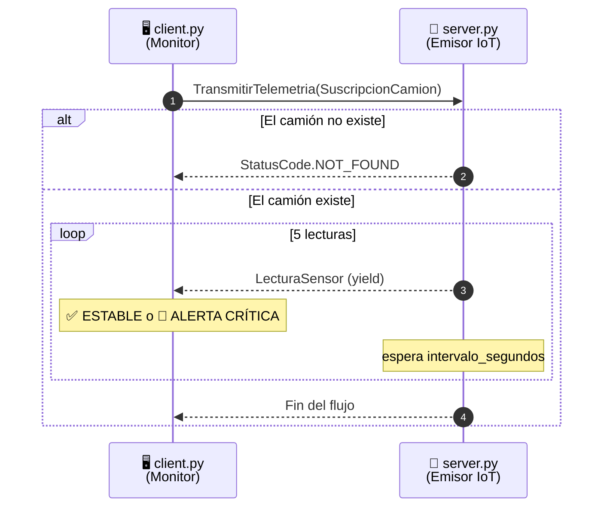
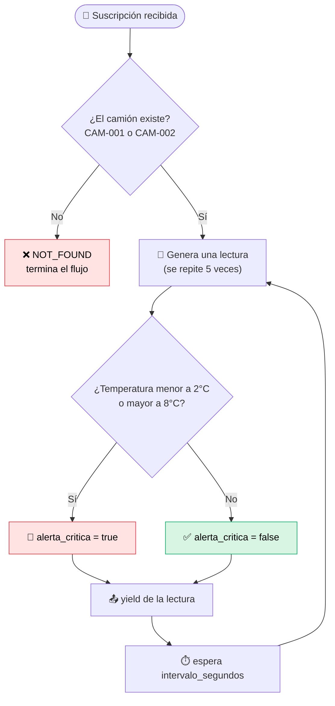

<div align="center">

# 🚚 Monitor en Tiempo Real de Telemetría IoT

### gRPC Server Streaming · Ejercicio 2

Sistema de logística farmacéutica que vigila la **cadena de frío** de camiones en ruta, recibiendo un flujo continuo de temperatura y ubicación con **gRPC** y **Protocol Buffers**.

<br />


</div>

---

## 📑 Tabla de contenido

- [Objetivo del proyecto](#-objetivo-del-proyecto)
- [Tecnologías utilizadas](#️-tecnologías-utilizadas)
- [Cómo funciona](#-cómo-funciona)
- [Contrato Protobuf](#-contrato-protobuf)
- [Reglas de negocio](#-reglas-de-negocio)
- [Estructura del proyecto](#-estructura-del-proyecto)
- [Guía de ejecución paso a paso](#-guía-de-ejecución-paso-a-paso)
- [Casos de prueba incluidos](#-casos-de-prueba-incluidos)
- [Solución de problemas](#-solución-de-problemas)

---

## 🎯 Objetivo del Proyecto

Este proyecto simula un sistema de logística farmacéutica donde mantener la cadena de frío es vital. Utiliza el patrón **Server Streaming de gRPC** para recibir un flujo continuo de datos de temperatura y ubicación desde camiones en ruta. ❄️🌡️

Implementar un servicio donde el cliente solicita la suscripción a un camión específico y el servidor responde transmitiendo una serie de lecturas continuas (usando `yield`). El cliente debe detectar y alertar visualmente si la temperatura sale del rango permitido (2°C - 8°C).

> 💡 **Server Streaming:** el cliente envía **una** petición y el servidor responde con **varias** lecturas, una tras otra, sin que el cliente tenga que volver a preguntar.

| Patrón | Petición | Respuesta | Ejemplo en este curso |
| :--- | :---: | :---: | :--- |
| **Unario** | 1 | 1 | Ejercicio 1 · Validación de pagos |
| **Server Streaming** 📡 | 1 | N | **Ejercicio 2 · Telemetría IoT** |

---

## 🛠️ Tecnologías Utilizadas

| Componente | Tecnología |
| :--- | :--- |
| 🐍 **Lenguaje** | Python 3.x |
| ⚡ **Framework RPC** | gRPC (`grpcio`, `grpcio-tools`) |
| 📡 **Patrón gRPC** | Server Streaming (1 Petición → N Respuestas) |
| 📦 **Serialización** | Protocol Buffers (proto3) |
| 🧵 **Concurrencia del servidor** | `ThreadPoolExecutor` con 10 hilos |
| 🔌 **Puerto** | `50052` (canal sin cifrado, solo para desarrollo) |

---

## 🧠 Cómo funciona



---

## 📜 Contrato Protobuf

El archivo `telemetria.proto` define el servicio y los dos mensajes. Fíjate en la palabra clave **`stream`** en la respuesta: es lo que convierte la llamada en un flujo.

**Servicio:** `MonitorCadenaFrio` → método `TransmitirTelemetria(SuscripcionCamion) returns (stream LecturaSensor)`

<table>
<tr>
<td valign="top">

**📤 `SuscripcionCamion`**

| # | Campo | Tipo |
| :-: | :--- | :--- |
| 1 | `id_camion` | `string` |
| 2 | `intervalo_segundos` | `int32` |

</td>
<td valign="top">

**📥 `LecturaSensor`** *(se repite en el flujo)*

| # | Campo | Tipo |
| :-: | :--- | :--- |
| 1 | `id_camion` | `string` |
| 2 | `temperatura_celsius` | `double` |
| 3 | `latitud` | `double` |
| 4 | `longitud` | `double` |
| 5 | `timestamp` | `string` |
| 6 | `alerta_critica` | `bool` |

</td>
</tr>
</table>

---

## 🛡️ Reglas de negocio



| # | Regla | Resultado |
| :-: | :--- | :--- |
| 1️⃣ | Validar que el camión exista (`CAM-001` o `CAM-002`) | Si no existe: `NOT_FOUND` y se cierra el flujo |
| 2️⃣ | Emitir cada lectura mediante `yield` | El cliente recibe las 5 lecturas una a una |
| 3️⃣ | Marcar alerta crítica si la temperatura sale de rango | `alerta_critica = true` |

### 🌡️ Rango de temperatura permitido

```text
 0°C ········ 2°C ═══════════════ 8°C ········ 10°C
 🚨 ALERTA   │  ✅ ESTABLE (cadena de frío OK)  │   🚨 ALERTA
 (muy frío)  └──────────────────────────────────┘   (muy caliente)
```

> 🎲 El servidor **simula** los sensores generando temperaturas aleatorias entre `0.0°C` y `10.0°C`, y coordenadas cercanas a Quito. Por eso cada ejecución muestra lecturas distintas y es normal ver varias alertas.

---

## 📂 Estructura del proyecto

```text
Ejercicio_2_Telemetria_IoT_Streaming/
├── 📄 telemetria.proto          # Contrato del servicio (fuente de verdad)
├── ⚙️ telemetria_pb2.py         # Mensajes generados por protoc
├── ⚙️ telemetria_pb2_grpc.py    # Stub y servicer generados por protoc
├── 📡 server.py                 # Servidor emisor de telemetría (streaming)
├── 🖥️ client.py                 # Cliente monitor con alertas en consola
├── 📋 requirements.txt          # Dependencias: grpcio, grpcio-tools, protobuf
└── 📖 README.md                 # Esta guía
```

> ℹ️ `telemetria_pb2.py` y `telemetria_pb2_grpc.py` se **generan automáticamente** a partir de `telemetria.proto` en el paso 2. No se editan a mano.

---

## 🚀 Guía de Ejecución Paso a Paso

Sigue estos pasos para iniciar el monitor de telemetría.

### 1️⃣ Preparar el Entorno

Asegúrate de tener tu entorno virtual activado. Si estás en la raíz del proyecto principal (Windows), usa:
```bash
.\.venv\Scripts\activate
```
Si aún no tienes las dependencias, instálalas desde esta carpeta:
```bash
pip install -r requirements.txt
```

### 2️⃣ Compilar el Contrato Protobuf

Asegúrate de estar en la carpeta de este ejercicio:
```bash
cd Ejercicio_2_Telemetria_IoT_Streaming
```
Genera los archivos de Python para gRPC ejecutando:
```bash
python -m grpc_tools.protoc -I. --python_out=. --grpc_python_out=. telemetria.proto
```
*(Se generarán los archivos `telemetria_pb2.py` y `telemetria_pb2_grpc.py`).*

### 3️⃣ Levantar el Servidor (Emisor IoT)

En la misma terminal, inicia el servidor de telemetría:
```bash
python server.py
```
Verás el mensaje: `Servidor gRPC de Telemetría (Streaming) iniciado en el puerto 50052...` 📡
*(Nota: Usamos el puerto 50052 para evitar conflictos con el Ejercicio 1).*

### 4️⃣ Ejecutar el Cliente (Monitor)

Abre **una nueva pestaña de terminal**, activa el entorno virtual, ingresa a la carpeta `Ejercicio_2_Telemetria_IoT_Streaming` y ejecuta el cliente:
```bash
python client.py
```

---

## 🧪 Casos de Prueba Incluidos

El cliente consumirá el *stream* de datos y evaluará dos escenarios:

| # | Escenario | Qué envía el cliente | Resultado esperado |
| :-: | :--- | :--- | :--- |
| 1 | 🟢/🚨 **Suscripción Exitosa** | Camión `CAM-001`, intervalo de `1` segundo | 5 lecturas en tiempo real (`✅ ESTABLE` o `🚨 ALERTA CRÍTICA`) |
| 2 | ❌ **Camión No Encontrado** | Camión `CAM-999`, intervalo de `1` segundo | Error gRPC `NOT_FOUND` |

1. 🟢/🚨 **Suscripción Exitosa (CAM-001):** Recibirás 5 lecturas en tiempo real (1 cada segundo). 
   * Si la temperatura está entre 2°C y 8°C, se mostrará un mensaje de estado `✅ ESTABLE`.
   * Si la temperatura sale de ese rango, el sistema arrojará una `🚨 ALERTA CRÍTICA 🚨` resaltada.
2. ❌ **Camión No Encontrado (CAM-999):** Se enviará el código gRPC `NOT_FOUND`, simulando que se ingresó un camión que no existe en el sistema.

### 🖨️ Salida esperada en consola

<details open>
<summary><b>Terminal 1 · Servidor</b></summary>

```text
Servidor gRPC de Telemetría (Streaming) iniciado en el puerto 50052...
Iniciando transmisión de telemetría para CAM-001...
```

</details>

<details open>
<summary><b>Terminal 2 · Cliente</b></summary>

```text
=== Suscribiéndose al flujo del camión: CAM-001 ===
✅ ESTABLE: [2026-11-16 22:53:07] CAM-001 | Temp: 4.0°C | Pos: (-0.2409, -78.5093)
✅ ESTABLE: [2026-11-16 22:53:08] CAM-001 | Temp: 7.0°C | Pos: (-0.2379, -78.4912)
🚨 ALERTA CRÍTICA 🚨: [2026-11-16 22:53:09] CAM-001 | Temp: 8.7°C | Pos: (-0.2292, -78.51) -> ¡Fuera de rango (2°C - 8°C)!
🚨 ALERTA CRÍTICA 🚨: [2026-11-16 22:53:10] CAM-001 | Temp: 9.6°C | Pos: (-0.2075, -78.5029) -> ¡Fuera de rango (2°C - 8°C)!
🚨 ALERTA CRÍTICA 🚨: [2026-11-16 22:53:11] CAM-001 | Temp: 9.1°C | Pos: (-0.217, -78.5236) -> ¡Fuera de rango (2°C - 8°C)!

=== Suscribiéndose al flujo del camión: CAM-999 ===
❌ Excepción gRPC capturada:
Código de estado: StatusCode.NOT_FOUND
Detalle: El camión CAM-999 no existe en el sistema.
```

> 🎲 Las temperaturas, coordenadas y fechas cambian en cada ejecución, porque los datos se generan al azar. Las lecturas llegan una por segundo, no todas juntas.

</details>

### 🔬 Prueba extra: segundo camión válido

El cliente no usa el camión `CAM-002`, que también existe en el servidor. Para probarlo con otro intervalo, agrega esta línea dentro de `run()` en `client.py`:

```python
# Prueba 3: Otro camión válido, una lectura cada 2 segundos
monitorear_camion(stub, id_camion="CAM-002", intervalo=2)
```

---

## 🩺 Solución de problemas

| Problema | Causa probable | Solución |
| :--- | :--- | :--- |
| `ModuleNotFoundError: telemetria_pb2` | No se compiló el `.proto` | Ejecuta el comando del **paso 2** dentro de la carpeta del ejercicio |
| `RuntimeError: The grpc package installed is at version…` | El código generado necesita una versión de `grpcio` más nueva | Ejecuta `pip install -U grpcio grpcio-tools protobuf` y vuelve a compilar el `.proto` |
| `StatusCode.UNAVAILABLE` en el cliente | El servidor no está en ejecución | Inicia `python server.py` en otra terminal antes del cliente |
| `Address already in use` | El puerto `50052` está ocupado | Cierra la otra instancia del servidor o cambia el puerto en `server.py` y `client.py` |
| Las lecturas no se parecen a las del ejemplo | Los datos son aleatorios | Es el comportamiento normal: cada ejecución genera valores distintos |
| El comando `activate` no funciona en PowerShell | Política de ejecución de scripts | Ejecuta `Set-ExecutionPolicy -Scope CurrentUser RemoteSigned` y vuelve a intentarlo |

---

<div align="center">

<sub>📡 Hecho con gRPC y Protocol Buffers · Ejercicio 2 · Patrones gRPC en Python</sub>

</div>