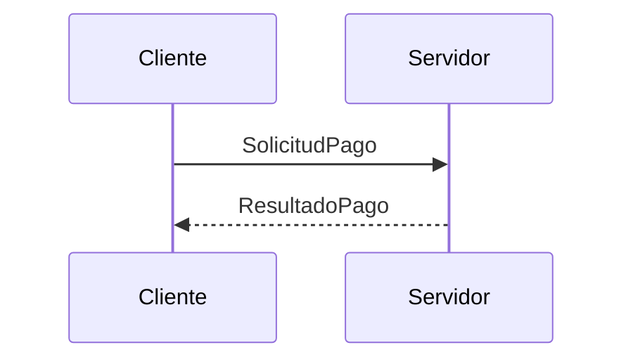
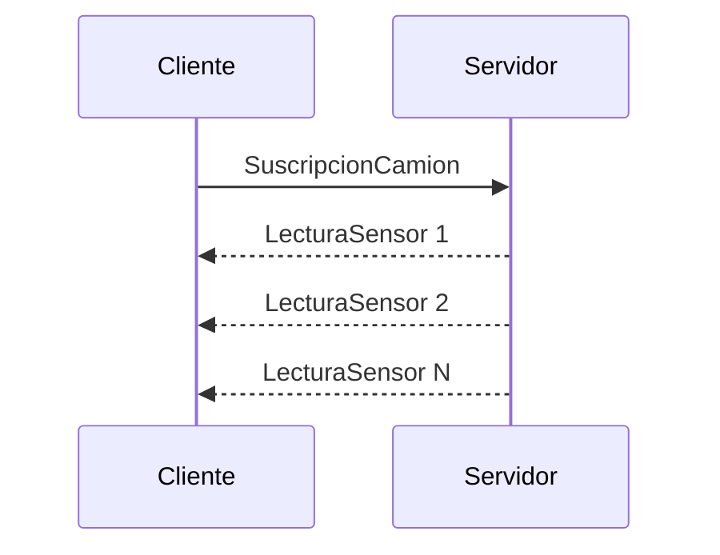

<div align="center">

# ⚡ Práctica: Patrones gRPC en Python

### Dos microservicios, dos patrones de comunicación

Colección de ejercicios prácticos que implementan **patrones de comunicación de gRPC** con **Python** y **Protocol Buffers**: un servicio de validación de pagos (**unario**) y un monitor de telemetría IoT (**server streaming**).

<br />


</div>

---

## 📑 Tabla de contenido

- [Sobre el proyecto](#-sobre-el-proyecto)
- [Ejercicios incluidos](#-ejercicios-incluidos)
- [Los patrones, de un vistazo](#-los-patrones-de-un-vistazo)
- [Estructura del repositorio](#-estructura-del-repositorio)
- [Inicio rápido](#-inicio-rápido)
- [Conceptos que se practican](#-conceptos-que-se-practican)
- [Autor](#-autor)

---

## 📖 Sobre el proyecto

**gRPC** es un framework de llamadas a procedimientos remotos (RPC) de alto rendimiento. En lugar de enviar texto como una API REST, define un **contrato** en un archivo `.proto` y genera automáticamente el código del cliente y del servidor en el lenguaje elegido.

Este repositorio reúne ejercicios independientes, cada uno con su propio contrato, servidor, cliente y guía de ejecución. Cada ejercicio muestra un **patrón de comunicación distinto** aplicado a un caso de la vida real.

---

## 🧩 Ejercicios incluidos

<table>
<tr>
<td width="50%" valign="top">

### 🛒 Ejercicio 1
**Validación de Pagos**

`Patrón unario · 1 → 1`

Microservicio que valida transacciones de e-commerce en tiempo real y responde si el pago es `APROBADA` o `RECHAZADA`, aplicando reglas de negocio y políticas antifraude.

- ❌ `INVALID_ARGUMENT` para montos o tarjetas inválidas
- 🚨 `PERMISSION_DENIED` para tarjetas en lista negra
- ⛔ Rechazo por política de fraude en montos altos
- 🔌 Puerto `50051`

**[📖 Ver guía del Ejercicio 1 →](./Ejercicio_1_Validacion_Pagos_Unario/README.md)**

</td>
<td width="50%" valign="top">

### 🚚 Ejercicio 2
**Telemetría IoT en Tiempo Real**

`Server Streaming · 1 → N`

Monitor de cadena de frío para logística farmacéutica. El servidor transmite lecturas continuas de temperatura y ubicación, y el cliente alerta si salen del rango de 2°C a 8°C.

- 📡 Flujo de lecturas con `yield`
- 🚨 Alertas críticas resaltadas en consola
- ❌ `NOT_FOUND` para camiones inexistentes
- 🔌 Puerto `50052`

**[📖 Ver guía del Ejercicio 2 →](./Ejercicio_2_Telemetria_IoT_Streaming/README.md)**

</td>
</tr>
</table>

---

## 🔀 Los patrones, de un vistazo

### 🛒 Ejercicio 1 · Unario (1 → 1)

El cliente envía **una** solicitud y recibe **una** respuesta.



### 🚚 Ejercicio 2 · Server Streaming (1 → N)

El cliente envía **una** suscripción y recibe **varias** lecturas, una tras otra.



### 📊 Cobertura de patrones gRPC

| Patrón gRPC | Petición | Respuesta | En este repositorio |
| :--- | :---: | :---: | :---: |
| **Unario** | 1 | 1 | ✅ Ejercicio 1 |
| **Server Streaming** | 1 | N | ✅ Ejercicio 2 |
| **Client Streaming** | N | 1 | ➖ No incluido |
| **Streaming bidireccional** | N | N | ➖ No incluido |

---

## 📂 Estructura del repositorio

```text
Practica_Patrones_gRPC_Python/
├── 🛒 Ejercicio_1_Validacion_Pagos_Unario/
│   ├── pagos.proto            # Contrato del servicio
│   ├── pagos_pb2.py           # Código generado (mensajes)
│   ├── pagos_pb2_grpc.py      # Código generado (stub y servicer)
│   ├── server.py              # Servidor con reglas antifraude
│   ├── client.py              # Cliente con 3 casos de prueba
│   ├── requirements.txt
│   └── README.md
│
├── 🚚 Ejercicio_2_Telemetria_IoT_Streaming/
│   ├── telemetria.proto       # Contrato del servicio
│   ├── telemetria_pb2.py      # Código generado (mensajes)
│   ├── telemetria_pb2_grpc.py # Código generado (stub y servicer)
│   ├── server.py              # Servidor emisor de telemetría
│   ├── client.py              # Cliente monitor con alertas
│   ├── requirements.txt
│   └── README.md
│
├── .gitignore
└── README.md                  # Esta guía
```

---

## 🚀 Inicio rápido

Los dos ejercicios usan las mismas herramientas, así que el proceso es igual en ambos. Solo cambian la carpeta y el puerto.

| | 🛒 Ejercicio 1 | 🚚 Ejercicio 2 |
| :--- | :--- | :--- |
| **Carpeta** | `Ejercicio_1_Validacion_Pagos_Unario` | `Ejercicio_2_Telemetria_IoT_Streaming` |
| **Contrato** | `pagos.proto` | `telemetria.proto` |
| **Puerto** | `50051` | `50052` |

### 1️⃣ Clonar y preparar el entorno

```powershell
git clone https://github.com/xErnyx/Practica_Patrones_gRPC_Python.git
cd Practica_Patrones_gRPC_Python

python -m venv .venv
.\.venv\Scripts\activate
pip install grpcio grpcio-tools protobuf
```

### 2️⃣ Elegir un ejercicio y compilar su contrato

Entra a la carpeta del ejercicio y genera el código de gRPC. Por ejemplo, para el **Ejercicio 1**:

```powershell
cd Ejercicio_1_Validacion_Pagos_Unario
python -m grpc_tools.protoc -I. --python_out=. --grpc_python_out=. pagos.proto
```

Para el **Ejercicio 2**, usa `telemetria.proto`:

```powershell
cd Ejercicio_2_Telemetria_IoT_Streaming
python -m grpc_tools.protoc -I. --python_out=. --grpc_python_out=. telemetria.proto
```

### 3️⃣ Levantar el servidor y ejecutar el cliente

Abre **dos terminales** dentro de la carpeta del ejercicio, con el entorno virtual activado:

```powershell
# Terminal 1: servidor
python server.py

# Terminal 2: cliente
python client.py
```

> 💡 Cada ejercicio usa un **puerto distinto**, así que puedes dejar los dos servidores encendidos al mismo tiempo sin que choquen.

> 📖 Para ver la salida esperada, el contrato completo y la solución de problemas, abre la guía de cada ejercicio.

---

## 🎓 Conceptos que se practican

| Concepto | Dónde se ve |
| :--- | :--- |
| 📄 **Contrato `.proto`** (servicios y mensajes) | Ambos ejercicios |
| ⚙️ **Generación de código** con `grpc_tools.protoc` | Ambos ejercicios |
| 🔁 **Llamada unaria** (1 petición → 1 respuesta) | Ejercicio 1 |
| 📡 **Server streaming** con `yield` (1 petición → N respuestas) | Ejercicio 2 |
| 🚦 **Códigos de estado gRPC** (`INVALID_ARGUMENT`, `PERMISSION_DENIED`, `NOT_FOUND`) | Ambos ejercicios |
| 🛡️ **Reglas de negocio** en el servidor | Ambos ejercicios |
| 🧵 **Servidor concurrente** con `ThreadPoolExecutor` | Ambos ejercicios |
| 🧪 **Manejo de errores** con `grpc.RpcError` en el cliente | Ambos ejercicios |

---

## 👤 Autor

<div align="center">

<a href="https://github.com/xErnyx">
  
</a>

<h3>Juan Figueroa</h3>

<b>Estudiante de Computación · Sistemas distribuidos y desarrollo de software</b>

<a href="https://github.com/xErnyx"></a>
<a href="https://github.com/xErnyx?tab=repositories"></a>


</div>

<br />

<div align="center">
  <sub>⚡ Hecho con gRPC y Protocol Buffers · Patrones de comunicación en Python</sub>
</div>


